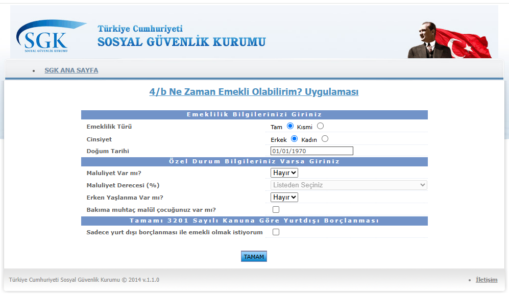
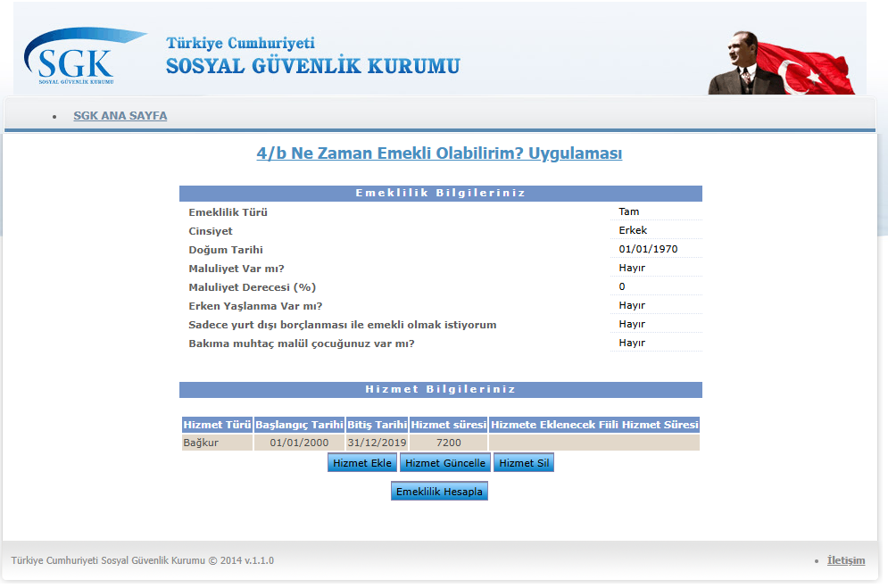
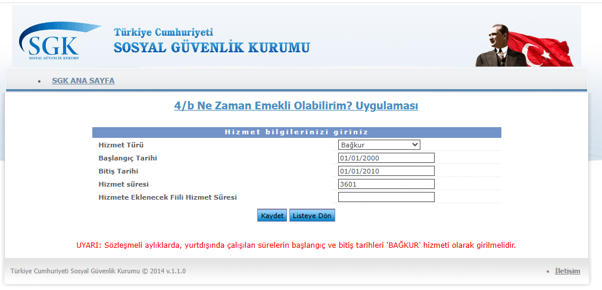
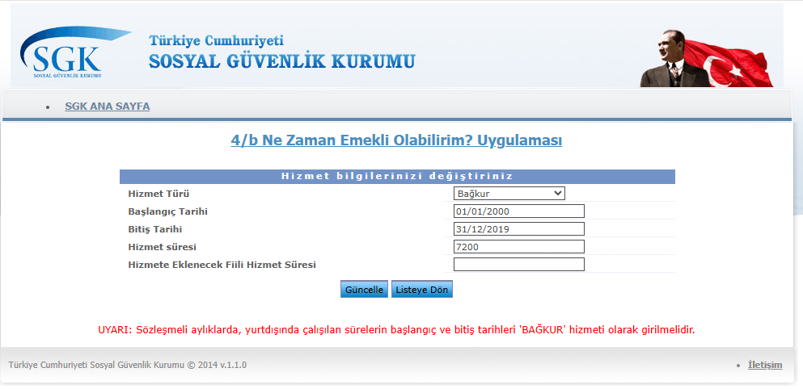

# 4/b Ne Zaman Emekli Olabilirim? Uygulaması
## 01 – Uygulama Genel Tanımı

| | |
| --- | --- |
| Doküman sürümü | 0.2 (taslak) |
| Tarih | 12.10.2026 |
| Hazırlayan | Hallaç Mansur AKBAŞ |

---

## 1. Amaç

Uygulama, Bağkur (5510 sayılı Kanun 4/b) sigortalılarının girdikleri kişisel bilgiler ve hizmet dönemlerine göre **hangi tarihte emekli olabileceklerini** hesaplar. Sonuçta kişinin mevcut yaşı ve süreleri, emeklilik için gereken şartlar ve bu şartlara ulaşmak için kalan süreler gösterilir.

- Sosyal Güvenlik Kurumu web uygulamasıdır; mevcut sürüm v.1.1.0 (2014).
- Hesaplama, uygulamanın kullanıldığı gün esas alınarak yapılır.
- Sonuçlar bilgilendirme amaçlıdır; resmi işlemlerde kullanılamaz, Kurum kayıtları esastır.
- Vatandaş tarafından ne zaman emekli olacağını görmek için kullanılır.

## 2. Kapsam

**Kapsananlar**

- 4/b (Bağkur) sigortalıları
- Tam ve kısmi emeklilik
- Özel durumlar: maluliyet (derecesiyle birlikte), erken yaşlanma, bakıma muhtaç malül çocuk sahibi olma
- Tamamı 3201 sayılı Kanuna göre yurt dışı borçlanması ile emeklilik
- Bağkur dışındaki kurumlarda geçen hizmetler de girilebilir. Ancak son 7 yıldaki veya toplam hizmete göre ağırlıklı kurum Bağkur değilse uygulama 4/b'den emeklilik hesabı yapmaz.

**Kapsam dışı**

- Kullanıcı girişi yoktur; girilen bilgiler kaydedilmez, oturum kapandığında silinir.

**Dayandığı mevzuat:** 5510 sayılı Kanun 4/b, 3201 sayılı Kanun. %%


## 3. Kullanıcılar ve Roller

| Rol | Kim? | Ne yapabilir? | Giriş şekli |
|---|---|---|---|
| **Vatandaş** | 5510 4/1-b kapsamında sigortalı olan kişi | Sigortalılık başlangıç tarihi, doğum tarihi, cinsiyet, prim ödeme gün sayısı ve gerekli diğer bilgileri girerek yaşlılık aylığına hak kazanabileceği tarihi hesaplayabilir ve sonucu görüntüleyebilir. | Giriş yok |

---

## 4. Kullanıcıdan Alınan Bilgiler

**Emeklilik bilgileri** (bir kez girilir)

- Emeklilik türü: Tam / Kısmi
- Cinsiyet
- Doğum tarihi
- Maluliyet var mı? Varsa maluliyet derecesi (%)
- Erken yaşlanma var mı?
- Bakıma muhtaç malül çocuğu var mı?
- Sadece yurt dışı borçlanması ile emekli olmak istiyor mu?

**Hizmet bilgileri** (her hizmet dönemi için ayrı girilir, birden çok dönem eklenebilir)

- Hizmet türü (ör. Bağkur)
- Başlangıç tarihi
- Bitiş tarihi
- Hizmet süresi (gün) **başlangıç ve bitiş tarihine göre kendi hesaplıyor**
- Hizmete eklenecek fiili hizmet süresi (gün, isteğe bağlı)

Sözleşmeli aylıklarda yurt dışında çalışılan sürelerin "Bağkur" hizmeti olarak girilmesi gerekir. "Sadece yurt dışı borçlanması" seçildiyse yalnızca tek bir hizmet dönemi girilebilir.

Doğum tarihi, Hizmet Başlangıç Tarihi, Hizmet Bitiş Tarihi için alt veya üst sınır kontrolü yoktur.

## 5. Genel İş Akışı

```
Kullanıcı
   ↓
Emeklilik hesabı için gerekli bilgilerini girer
   ↓
Bilgiler kontrol edilir (hatalıysa aynı ekranda uyarı)
   ↓
Hizmet dönemlerini ekler, günceller veya siler
   ↓
"Emeklilik Hesapla"ya basar
   ↓
Ön kontroller yapılır
  - Bağkur hizmeti girilmiş mi?
  - Ağırlıklı çalışılan kurum Bağkur mu?
  (sağlanmıyorsa uyarı verilir, hesaplama yapılmaz)
   ↓
Emeklilik şartları ve kalan süreler hesaplanır
   ↓
Sonuç ve emeklilik tarihi aynı ekranda gösterilir
```

- Kullanıcı emeklilik bilgilerini değiştirmek isterse baştan başlar; bu durumda girdiği hizmetler silinir.
- Sonuç, hesaplamanın yapıldığı güne göre değişir. Aynı bilgiler farklı bir günde farklı sonuç verebilir.

## 6. Ekranlar

Ekran kimlikleri (EK-xx) diğer dokümanlarda da aynı ekranı göstermek için kullanılır.

| Ekran ID | Ekran | Ne yapılır |
| --- | --- | --- |
| EK-01 | Emeklilik bilgileri girişi | Açılış ekranı. Kişisel bilgiler ve özel durumlar girilir. |
| EK-02 | Hizmet bilgileri ve sonuç | Girilen emeklilik bilgileri özetlenir, hizmet dönemleri listelenir. Hizmet ekleme, güncelleme, silme ve emeklilik hesaplama buradan yapılır. Hesaplama sonucu aynı ekranın altında gösterilir. |
| EK-03 | Hizmet ekleme | Yeni bir hizmet dönemi girilir. |
| EK-04 | Hizmet güncelleme | Listeden seçilen hizmet dönemi düzenlenir. |

**Hesaplama sonucunda gösterilenler**

- Sigortalılık bilgileri: yaş, sigortalılık süresi, hizmet süresi
- Emeklilik şartları: gereken yaş, sigortalılık süresi ve hizmet süresi
- Hak kazanma sonucu: kalan yaş, kalan sigortalılık süresi, kalan hizmet süresi ve emekli olunabilecek tarih
- Uyarılar: genel sağlık sigortası dahil prim borcu olmaması gerektiği; sonuçların bilgilendirme amaçlı olduğu

**Uyarı ve hata durumları**

- Bilgi girişinde eksik veya hatalı alan mesajları
- Listeden satır seçmeden güncelleme veya silme
- Silme öncesi onay
- "Sadece yurt dışı borçlanması" seçiliyken ikinci hizmet ekleme
- Bağkur hizmeti girmeden hesaplama
- Ağırlıklı çalışılan kurumun Bağkur olmaması
- Çoktan emekliliği hak ettiyse bunu direk desin. "01/01/2022 tarihinde emekli olabilirsiniz." gibi bir mesaj yerine direk söylesin. 


*EK-01. Giriş sayfası*
.png)
*EK-02. Sonuç sayfası*

*EK-02. Listeleme sayfası*

*EK-03. Ekleme sayfası*

*EK-04. Güncelleme sayfası*
